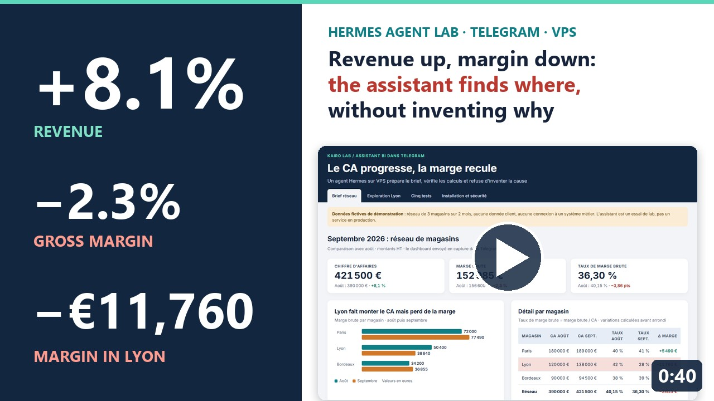
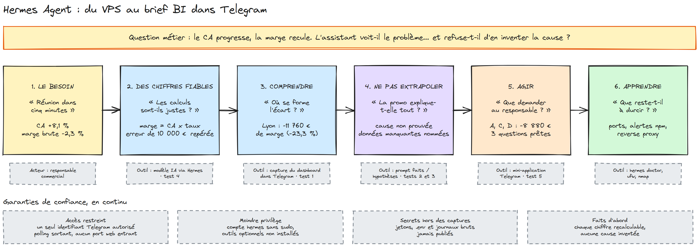
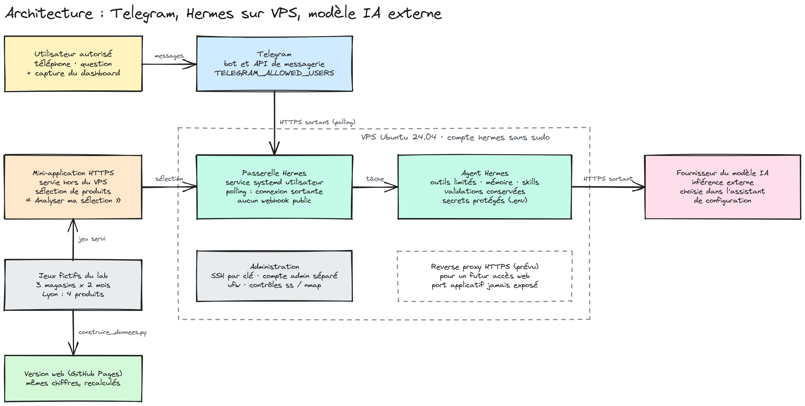
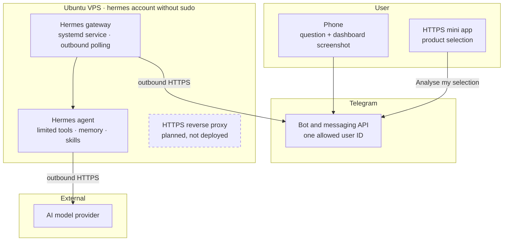

# Hermes: an AI assistant that delivers the BI brief in Telegram, and refuses to make up the cause

<a href="README.md"></a>&nbsp;<a href="README.en.md"></a>

## The project on video

<table>
  <tr>
    <td width="420" valign="top">
      <a href="https://cnanaj-wq.github.io/hermes-brief-bi/video.html"></a>
    </td>
    <td valign="top">
      <a href="https://cnanaj-wq.github.io/hermes-brief-bi/video.html"><b>Revenue up, margin down: the assistant finds where, and refuses to invent why</b></a><br><br>
      Cédric NANA · Data Analytics Consultant<br>
      ▷ 0:40 · no voice-over (on-screen text in French)<br><br>
      A Hermes agent on a VPS, a Telegram bot, five business tests on fictional data: the lab in 40 seconds.
    </td>
  </tr>
</table>

**See the interactive dashboard: https://cnanaj-wq.github.io/hermes-brief-bi/** (in French)



> Diagrams editable on [excalidraw.com](https://excalidraw.com) (Menu › Open): [`design/fil-du-projet.excalidraw`](design/fil-du-projet.excalidraw) · [`design/architecture.excalidraw`](design/architecture.excalidraw)

## The project

A DATA & AI lab: install [Hermes Agent](https://hermes-agent.nousresearch.com/docs/) (an open-source project by Nous Research)
on a VPS, connect it to an AI model and a Telegram bot, then check whether it is useful on a concrete BI case.
Hermes organises the model's work (conversation, tools, files, memory, reusable procedures called *skills*);
the model produces the answers.

This repository holds the web version of the lab: the two fictional datasets, the five tests and the installation path,
viewable online. The full story is in the article
[Installer Hermes : du VPS au brief BI dans Telegram](https://medium.com/@cedricnana/installer-hermes-du-vps-au-brief-bi-dans-telegram-38a898849869) (French).

## The business need

A sales meeting starts in five minutes. Revenue is up: is everything fine? Not necessarily.
The goal: send a dashboard screenshot from a phone and get back a figure-based brief, with the right questions
for the sales manager.

The lab answers three questions:

1. Does the assistant read the figures correctly and recompute them without error?
2. Can it locate the gap without inventing its cause?
3. Can you explore the data and get the analysis back in the same Telegram conversation?

The starting point: in the demo dataset, network revenue grows by **8.1%** (€390,000 → €421,500)
but gross margin falls by **2.3%** (€156,600 → €152,985).

## The solution

| Step | What was done | Tool |
|---|---|---|
| Host | Ubuntu 24.04 VPS (2 vCPU, 8 GB: the trial's setup, not a minimum requirement), an admin account and a `hermes` account without sudo | Ubuntu, key-based SSH |
| Install | Official script downloaded and read before running, browser and computer-use components not installed | Hermes Agent |
| Connect | Bot created with BotFather, access limited to one numeric user ID, gateway as a persistent systemd service | Telegram, systemd |
| Analyse | Figure-based brief from a screenshot, facts separated from hypotheses | Hermes + AI model |
| Explore | Mini app opened from the bot: pick products, then "Analyse my selection" | Telegram Mini App |

Trust guarantees around the chain:

- **Restricted access:** `TELEGRAM_ALLOWED_USERS` limits the bot to a single ID; no inbound web port (polling).
- **Least privilege:** service account without sudo, optional tools not installed, approvals kept.
- **Secrets out of screenshots:** Telegram and provider tokens, the `.env` file and raw logs are never published.
- **Facts first:** every amount can be recomputed; the prompt requires separating facts from hypotheses.

## The architecture





- **Every flow starts from the VPS:** the gateway polls Telegram and calls the provider; no web port is open for the bot.
- **Inference is not local:** hosting Hermes on your own server does not keep messages on that server.
- **The mini app** is served over HTTPS separately from the VPS; it is not the reverse proxy planned for it.

### Operating scenarios

| Scenario | What happens | Observed result |
|---|---|---|
| First round trip | "Reply only 'Kairo opérationnel', without any tool" | Reply received: Telegram ↔ Hermes ↔ model validated |
| Dashboard screenshot | The image goes to Telegram, Hermes passes it to the model with the brief prompt | Three figure-based findings, Lyon first, three checks |
| Exploration | `/explorer` opens the mini app, the selection returns to the bot | Analysis and two charts in the same thread |
| Silent bot | `journalctl --user -u hermes-gateway.service`, Hermes logs, then `hermes gateway run -vv` | A single active instance; initial cause not attributable with certainty |
| Unauthorised user | ID missing from `TELEGRAM_ALLOWED_USERS` | Expected behaviour of the configuration: message refused (not tested in this lab) |

## The five-test decision flow

```mermaid
flowchart TD
  Q[Question received in Telegram] --> D{Is the needed data<br/>in the screenshot?}
  D -- no --> X[Say so and ask for<br/>the useful export · test 3]
  D -- yes --> C[Recompute every amount]
  C --> E{Is a stated figure<br/>inconsistent?}
  E -- yes --> F[Flag the gap and suggest<br/>a corrected wording · test 4]
  E -- no --> H{Does the question<br/>impose a cause?}
  H -- yes --> R[Locate without concluding:<br/>"does not prove its cause" · test 2]
  H -- no --> B[Brief: facts, priority,<br/>checks · tests 1 and 5]
```

| Test | Risk targeted | Result |
|---|---|---|
| 1. Sales brief | Reading or calculation error | Revenue +8.1%, margin −€3,615, rate −3.86 pts; Lyon −€11,760 (−23.3%) |
| 2. Hasty conclusion | Invented cause | "No: the dashboard locates the drop but does not prove its cause." |
| 3. Missing data | Answer without basis | Asks for a month × product × salesperson export |
| 4. Wrong figure | Error repeated as is | 138,000 × 0.28 = €38,640, not €48,640 |
| 5. Exploration | Losing the thread | A, C, D: revenue +11.11%, margin −€8,880; A and D = 83.11% of that drop |

## Business impact

- **A brief in one conversation:** three figure-based findings, one priority store and three questions for the manager, from a phone.
- **Verifiable calculations:** every amount in the brief can be recomputed from the screenshot; the deliberate €10,000 error is caught.
- **No invented cause:** the assistant locates the drop (Lyon, then A and D) and names the data needed to explain it.
- **A lean installation:** no inbound web port, a single allowed user, a service account without sudo.

What the lab does not prove: five trials on two fictional datasets are not a general validation. The "meeting in five
minutes" scenario expresses a need, not a timed performance. A 0.01-point rounding gap appeared in test 5. `hermes doctor`
reported missing optional dependencies and npm vulnerabilities, the external port check is still to be run and logged, and
the reverse proxy is only planned: the installation is not production-ready.

## The online dashboard

Four pages, no dependency, no server:

- **Brief réseau:** KPIs, margin by store and the test 1 answer.
- **Exploration Lyon:** the mini app replayed; pick products and the measure, and the analysis recomputes.
- **Cinq tests:** each request, the answer and what it shows.
- **Installation et sécurité:** the 10 steps, what is done (7), to do (2) and planned (1).

Locally:

```bash
python -m http.server 8000
```

then open http://localhost:8000. Figures come from `data.js`, generated by `python source/construire_donnees.py`
from `source/donnees_demo.json`; the script checks that it finds the amounts published in the article.

## Data source

**Fictional** data created for the demo: a network of 3 stores (Paris, Lyon, Bordeaux) over August and September 2026,
and Lyon's breakdown by product (4 products, 8 observations). No customer data, no connection to Qlik, a data warehouse
or a business system. Values are taken from the screenshots published in the article; product B's values are derived from
Lyon's totals (the article details A, C and D). No working folder of the lab is published here.

---

Cédric NANA, Data Analytics Consultant.
