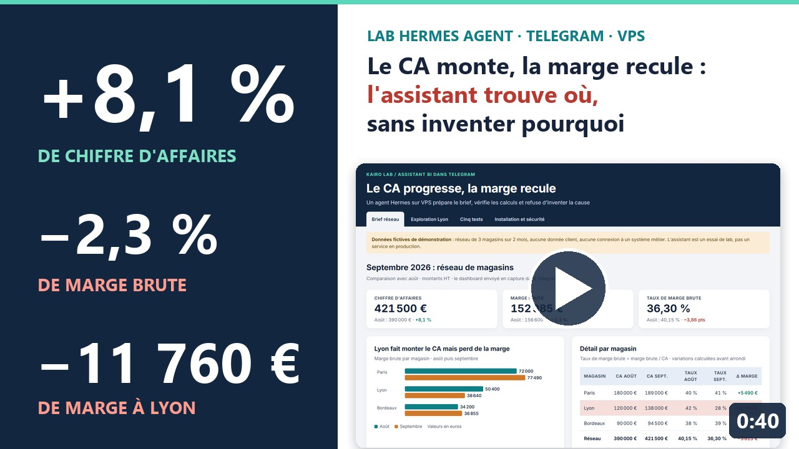
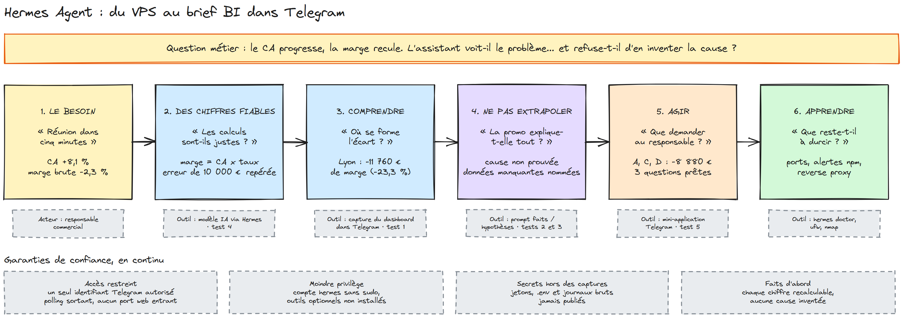
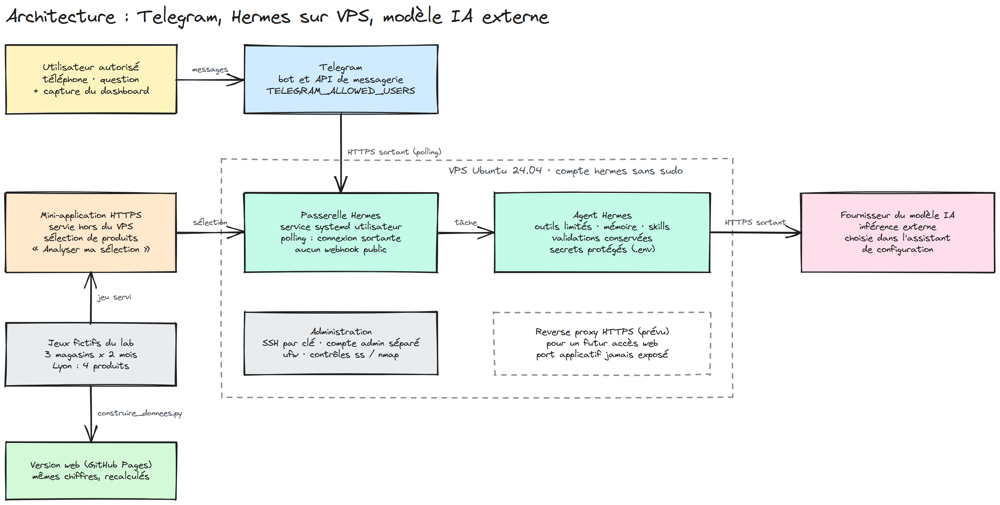
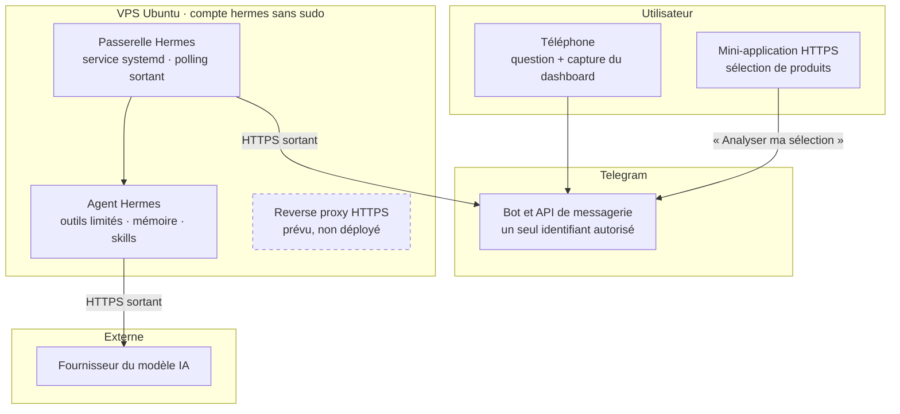
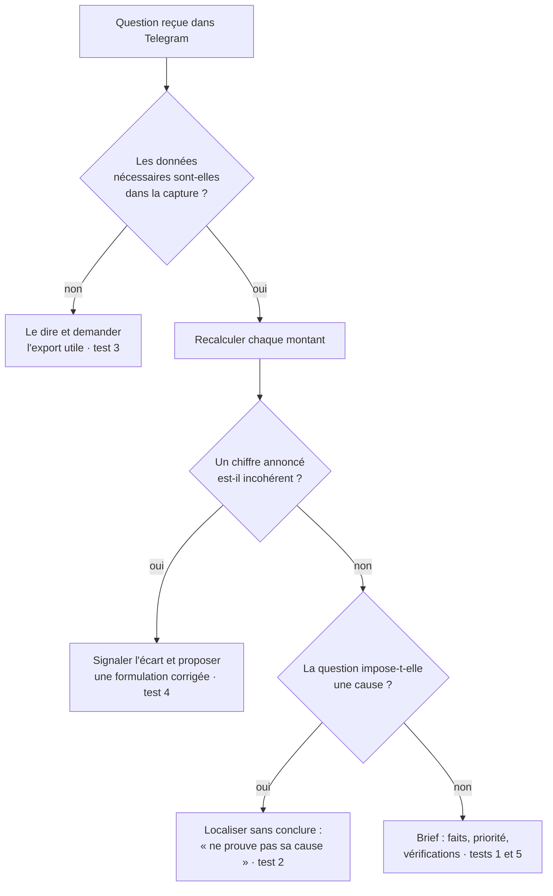

# Hermes : un assistant IA qui livre le brief BI dans Telegram, et refuse d'inventer la cause

<a href="README.md"></a>&nbsp;<a href="README.en.md"></a>

## Le projet en vidéo

<table>
  <tr>
    <td width="420" valign="top">
      <a href="https://cnanaj-wq.github.io/hermes-brief-bi/video.html"></a>
    </td>
    <td valign="top">
      <a href="https://cnanaj-wq.github.io/hermes-brief-bi/video.html"><b>Le CA monte, la marge recule : l'assistant trouve où, et refuse d'inventer pourquoi</b></a><br><br>
      Cédric NANA · Consultant Data Analytics<br>
      ▷ 0:40 · vidéo sans voix off<br><br>
      Un agent Hermes sur VPS, un bot Telegram, cinq tests métier sur données fictives : le lab en 40 secondes.
    </td>
  </tr>
</table>

**Voir le dashboard interactif : https://cnanaj-wq.github.io/hermes-brief-bi/**



> Schémas modifiables sur [excalidraw.com](https://excalidraw.com) (Menu › Ouvrir) : [`design/fil-du-projet.excalidraw`](design/fil-du-projet.excalidraw) · [`design/architecture.excalidraw`](design/architecture.excalidraw)

## Le projet

Un lab DATA & AI : installer [Hermes Agent](https://hermes-agent.nousresearch.com/docs/) (projet open source de Nous Research)
sur un VPS, le relier à un modèle IA et à un bot Telegram, puis vérifier s'il est utile sur un cas BI concret.
Hermes organise le travail du modèle (conversation, outils, fichiers, mémoire, procédures réutilisables appelées *skills*) ;
le modèle produit les réponses.

Ce dépôt contient la version web du lab : les deux jeux de données fictifs, les cinq tests et le parcours d'installation,
consultables en ligne. Le récit complet est dans l'article
[Installer Hermes : du VPS au brief BI dans Telegram](https://www.linkedin.com/pulse/installer-hermes-du-vps-au-brief-bi-dans-telegram-c%C3%A9dric-nana-pvxoe/).

## Le besoin métier

Une réunion commerciale commence dans cinq minutes. Le chiffre d'affaires monte : tout va bien ? Pas forcément.
L'objectif : envoyer une capture de dashboard depuis son téléphone et recevoir un brief chiffré, avec les bonnes questions
à poser au responsable commercial.

Le lab répond à trois questions :

1. L'assistant lit-il correctement les chiffres et les recalcule-t-il sans erreur ?
2. Sait-il localiser l'écart sans en inventer la cause ?
3. Peut-on explorer les données et retrouver l'analyse dans la même conversation Telegram ?

Le point de départ : dans le jeu de démonstration, le CA du réseau progresse de **8,1 %** (390 000 € → 421 500 €)
mais sa marge brute recule de **2,3 %** (156 600 € → 152 985 €).

## La solution mise en place

| Étape | Ce qui a été fait | Outil |
|---|---|---|
| Héberger | VPS Ubuntu 24.04 (2 vCPU, 8 Go : configuration de l'essai, pas un minimum requis), compte administrateur et compte `hermes` sans sudo | Ubuntu, SSH par clé |
| Installer | Script officiel téléchargé et relu avant exécution, composants navigateur et contrôle de l'ordinateur non installés | Hermes Agent |
| Connecter | Bot créé avec BotFather, accès limité à un identifiant numérique, passerelle en service systemd persistant | Telegram, systemd |
| Analyser | Brief chiffré à partir d'une capture, faits séparés des hypothèses | Hermes + modèle IA |
| Explorer | Mini-application ouverte depuis le bot : sélection de produits, puis « Analyser ma sélection » | Telegram Mini App |

Autour de la chaîne, des garanties de confiance :

- **Accès restreint :** `TELEGRAM_ALLOWED_USERS` limite le bot à un seul identifiant ; aucun port web entrant (polling).
- **Moindre privilège :** compte de service sans sudo, outils optionnels non installés, validations conservées.
- **Secrets hors des captures :** jetons Telegram et fournisseur, fichier `.env` et journaux bruts jamais publiés.
- **Faits d'abord :** chaque montant est recalculable ; le prompt impose de distinguer faits et hypothèses.

## L'architecture





- **Tous les flux partent du VPS :** la passerelle interroge Telegram et appelle le fournisseur ; aucun port web n'est ouvert pour le bot.
- **L'inférence n'est pas locale :** héberger Hermes sur son serveur ne garde pas les messages sur ce serveur.
- **La mini-application** est servie en HTTPS séparément du VPS ; elle n'est pas le reverse proxy prévu pour celui-ci.

### Scénarios de fonctionnement

| Scénario | Ce qui se passe | Résultat observé |
|---|---|---|
| Premier aller-retour | « Réponds uniquement “Kairo opérationnel”, sans outil » | Réponse reçue : Telegram ↔ Hermes ↔ modèle validé |
| Capture de dashboard | L'image part dans Telegram, Hermes la confie au modèle avec le prompt de brief | Trois constats chiffrés, Lyon prioritaire, trois vérifications |
| Exploration | `/explorer` ouvre la mini-application, la sélection revient au bot | Analyse et deux graphiques dans le même fil |
| Bot silencieux | `journalctl --user -u hermes-gateway.service`, journaux Hermes, puis `hermes gateway run -vv` | Une seule instance active ; cause initiale non attribuable avec certitude |
| Utilisateur non autorisé | Identifiant absent de `TELEGRAM_ALLOWED_USERS` | Comportement attendu de la configuration : message refusé (non testé dans ce lab) |

## Le logigramme des cinq tests



| Test | Risque visé | Résultat |
|---|---|---|
| 1. Brief commercial | Erreur de lecture ou de calcul | CA +8,1 %, marge −3 615 €, taux −3,86 pts ; Lyon −11 760 € (−23,3 %) |
| 2. Conclusion trop rapide | Cause inventée | « Non : le dashboard localise la baisse, mais ne prouve pas sa cause. » |
| 3. Données manquantes | Réponse sans base | Demande un export mois × produit × commercial |
| 4. Chiffre faux | Erreur reprise telle quelle | 138 000 × 0,28 = 38 640 €, et non 48 640 € |
| 5. Exploration | Perte du fil | A, C, D : CA +11,11 %, marge −8 880 € ; A et D = 83,11 % de cette baisse |

## L'impact métier

- **Un brief en une conversation :** trois constats chiffrés, un magasin prioritaire et trois questions au responsable, depuis un téléphone.
- **Des calculs vérifiables :** tous les montants du brief se recalculent à partir de la capture ; l'erreur volontaire de 10 000 € est repérée.
- **Pas de cause inventée :** l'assistant localise la baisse (Lyon, puis A et D) et nomme les données qui manquent pour l'expliquer.
- **Une installation sobre :** aucun port web entrant, un seul utilisateur autorisé, compte de service sans sudo.

Ce que le lab ne prouve pas : cinq essais sur deux jeux fictifs ne constituent pas une validation générale. Le scénario de la
« réunion dans cinq minutes » exprime un besoin, pas une performance chronométrée. Un écart d'arrondi de 0,01 point est apparu
au test 5. `hermes doctor` a signalé des dépendances optionnelles absentes et des vulnérabilités npm, le contrôle externe des
ports reste à réaliser et à consigner, et le reverse proxy est seulement prévu : l'installation n'est pas prête pour la production.

## Le dashboard en ligne

Quatre pages, sans dépendance ni serveur :

- **Brief réseau :** les KPI, la marge par magasin et la réponse du test 1.
- **Exploration Lyon :** la mini-application rejouée ; choisissez les produits, la mesure, et l'analyse se recalcule.
- **Cinq tests :** chaque demande, la réponse et ce qu'elle démontre.
- **Installation et sécurité :** les 10 étapes, ce qui est fait (7), à réaliser (2) et prévu (1).

En local :

```bash
python -m http.server 8000
```

puis ouvrir http://localhost:8000. Les chiffres viennent de `data.js`, généré par `python source/construire_donnees.py`
à partir de `source/donnees_demo.json` ; le script vérifie qu'il retrouve les montants publiés dans l'article.

## Source des données

Données **fictives** créées pour la démonstration : un réseau de 3 magasins (Paris, Lyon, Bordeaux) sur août et
septembre 2026, et le détail de Lyon par produit (4 produits, 8 observations). Aucune donnée client, aucune connexion à Qlik,
à un entrepôt de données ou à un système métier. Les valeurs sont relevées sur les captures publiées dans l'article ; celles du
produit B sont déduites des totaux de Lyon (l'article détaille A, C et D). Aucun dossier de travail du lab n'est publié ici.

---

Cédric NANA, consultant Data Analytics.
